<h1 style="font-family: Arial, sans-serif; font-size: 34px; color: #EAC360; display: flex; align-items: center; gap: 12px; border-bottom: 3px solid #EAC360; padding-bottom: 8px;">
  
  RIBIF - Industrial Investment Platform
</h1>

RIBIF is an end-to-end industrial project intelligence platform that transforms technical machine/material documentation into a complete virtual factory decision package.  
The platform combines technical extraction, procurement intelligence, financial simulation, and operational visualization in one workflow.

---

## Global Objective

RIBIF is designed to support industrial companies from pre-engineing to investment decision by chaining **9 modules** into one coherent process.

Input:
- Technical files (`PDF`, `DOCX`) and structured payloads

Output:
- Structured technical requirements
- Supplier shortlists with contact and pricing evidence
- Negotiation traces (email + voice)
- Multi-year TCO model
- Business plan and pitch deck outputs
- 2D/3D layout artifacts
- HD walkthrough video
- Digital twin KPI views
- Technical catalog deliverables

---

## Status

Stopped hackathon project, built during EliteHack. The frontend is deployed at [ribif-jade.vercel.app](https://ribif-jade.vercel.app). The pipeline itself depends on paid services (Gemini/Veo, Serper and other search APIs, Replicate, Presenton, Supabase, SMTP), which are not funded, so the live pipeline has not been run since.

The code was audited without calling any of those services. Local logic was run on sample data; each service call was replaced by a fake at its single client function and the code around it tested. The backend suite blocks all non-localhost network access.

| # | Module | Runs locally | Needs | Verification |
|---|--------|--------------|-------|--------------|
| 1 | Spec extraction | PDF/DOCX parsing, page selection, stage assembly, stage 5 normalization | Gemini (extraction, enrichment, machine images), web search (enrichment) | Mocked: Gemini faked, sample PDF/DOCX parsed for real |
| 2 | Factory layout | Placement, annealing, conveyor routing, PNG and DXF rendering | Gemini (machine flows, realistic render), Replicate (3D model), rembg model download | Verified locally with given flows; service steps not exercised |
| 3 | Video | Image intake and clip requests | Veo (Google GenAI), clip download | Mocked; the moviepy merge is not exercised |
| 4 | Supplier sourcing | Classification, budgets, dedup, filtering, contact parsing, AI fallback suppliers | Serper, Bing, DuckDuckGo, B2B marketplace scraping, Gemini | Mocked: search and Gemini faked |
| 5 | Negotiation | Offer scoring, counter-offer pricing, email building | Gemini (drafting), SMTP/IMAP, Vapi (voice, browser side), Supabase | Mocked: Gemini and SMTP faked; voice not exercised |
| 6 | TCO | TCO arithmetic, 5-year projection, heuristic fallbacks | Gemini (cost estimates) | Mocked: Gemini faked, arithmetic checked by hand |
| 7 | Business plan + pitch deck | P&L, NPV, IRR, payback, Excel workbook | Gemini (CapEx/OpEx/pricing), Presenton (deck) | Mocked: both faked |
| 8 | Digital twin | Telemetry simulation and 3D view (frontend only) | None | Verified locally (vitest) |
| 9 | Technical catalog | PDF built in memory with ReportLab | Image downloads, Supabase upload | Verified locally from the saved pipeline outputs, downloads faked |

Every route also persists to Supabase when it is configured; the tests run without it. Setting `SKIP_MODULE_<n>=1` makes modules 1–4, 6, 7 and 9 return their saved output from `backend/template/` without calling any service (`SKIP_MODULE_8` does the same for the pitch deck).

Bugs fixed during the audit: Module 5's routes had lost their imports and every negotiation endpoint raised `NameError`; `/api/module6/tco` always failed after an API change; Module 4 ran the same paid search four times per machine; Module 3 could send junk bytes to Veo as an image and misreported video length; email addresses on `.com.cn`/`.co.uk` domains were truncated; AI fallback prices showed mojibake (`€`); and the 2D plan drew nothing but conveyors when no machine images were available.

---

## Tech Used


Core stack:
- Backend: Python, Flask, Google GenAI (Gemini, Veo), Pydantic, ReportLab, ezdxf, XlsxWriter
- Frontend: Next.js App Router, React, TypeScript, Tailwind, Three.js/R3F
- Data and storage: Supabase

---

## Workflow Orchestration

The main workflow engine is implemented in `frontend/src/app/workflow/[id]/page.tsx`.

Execution order in the current pipeline:
1. Module 1 - Specification extraction
2. Module 4 - Supplier sourcing
3. Module 6 - TCO modeling
4. Module 7 - Business plan and pitch deck
5. Module 9 - Technical catalog
6. Module 2 - 2D/3D layout
7. Module 3 - Video rendering
8. Module 8 - Digital twin view (UI, not a blocking backend step)

This ordering prioritizes financial and procurement decisions early, then generates layout and visual outputs after constraints are stabilized.

---

## Module 1 - Tech Sheets and Needs Extraction

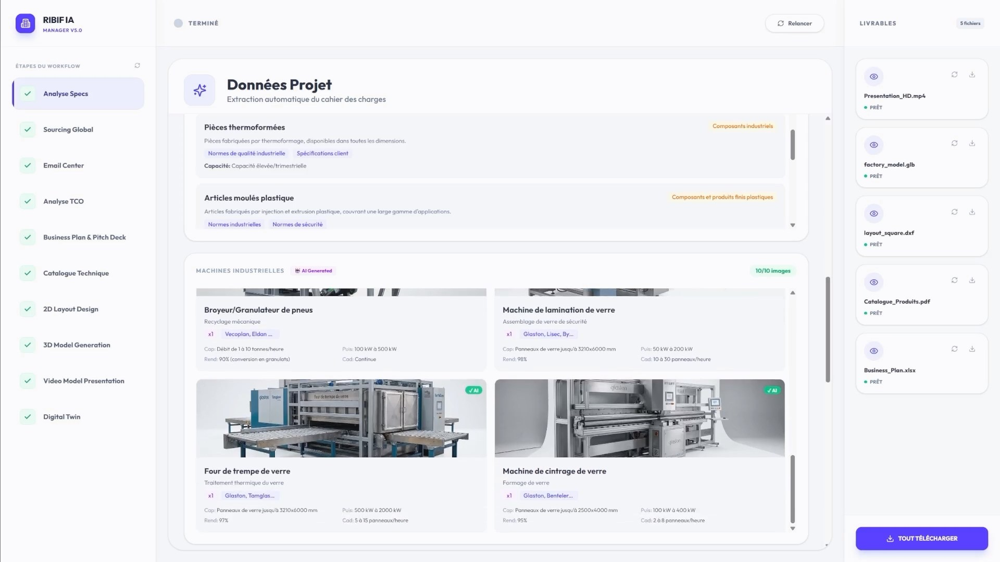

Business purpose:
- Ingest unstructured technical documents
- Extract machine/material specifications, capacities, utility constraints, and operational requirements
- Build normalized stage-based payloads for downstream modules

Implementation:
- Endpoint: `POST /api/module1/process`
- Status polling: `GET /api/module1/status`
- Result polling: `GET /api/module1/result`
- Route: `backend/routes/module1.py`
- Core logic: `backend/utils/module_1/`

Primary output:
- Structured extraction JSON (stages 1..6), including machine/equipment requirements

---

## Module 2 - Factory Layout (2D + 3D)

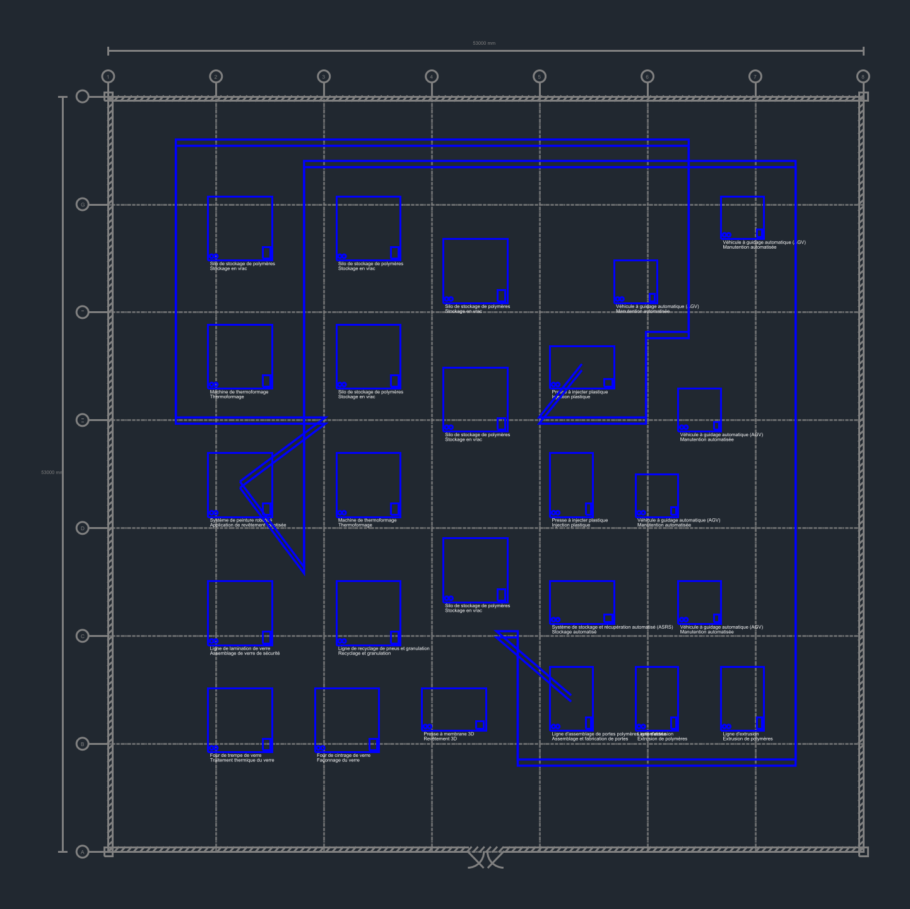
<br>
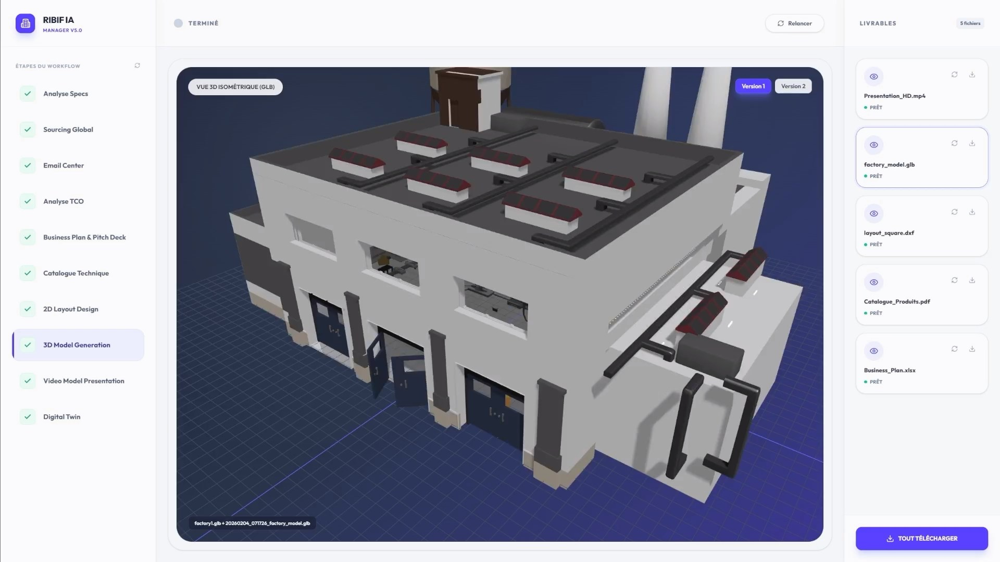

Business purpose:
- Convert technical extraction outputs into plant/workshop layout artifacts
- Generate 2D and 3D visualizations of zoning, flow, and equipment placement

Implementation:
- Endpoint: `POST /api/module2/layout`
- Route: `backend/routes/module2.py`
- Pipeline engine: `backend/utils/module_2/`

Primary output:
- 2D layout artifacts (DXF/PNG variants)
- 3D model artifacts (`GLB`-style workflow representation)

---

## Module 3 - HD Video Rendering

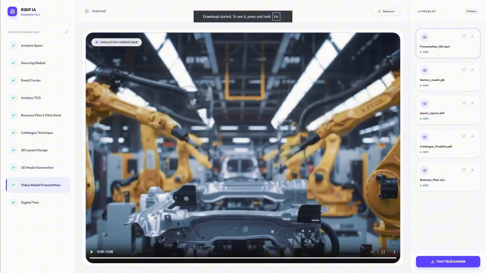

Business purpose:
- Generate investor-ready short walkthrough videos from layout/visual context

Implementation:
- Endpoint: `POST /api/module3/video`
- Route: `backend/routes/module3.py`

Primary output:
- HD video artifact (`.mp4`) and downloadable URL

---

## Module 4 - Automated Supplier Sourcing

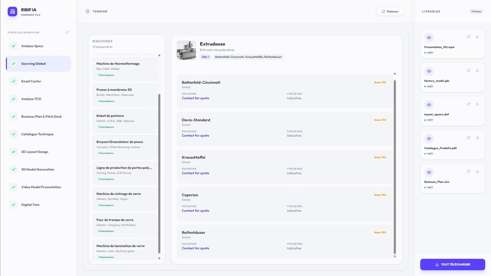

Business purpose:
- Discover supplier candidates globally
- Aggregate signals such as pricing, lead-time, and contact evidence
- Rank options per machine family

Implementation:
- Endpoint: `POST /api/module4/enrich`
- Route: `backend/routes/module4.py`
- Core logic: `backend/utils/module_4/`
- Search providers/aggregation: `backend/utils/web_search/`

Primary output:
- Enriched supplier lists with relevance and sourcing traces

---

## Module 5 - AI Negotiation (Email + Voice)

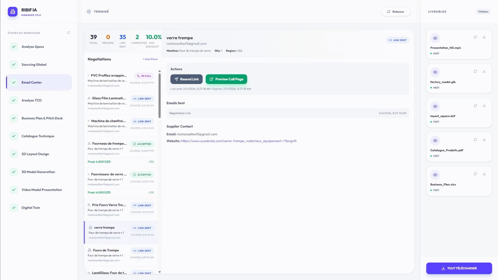
<br>
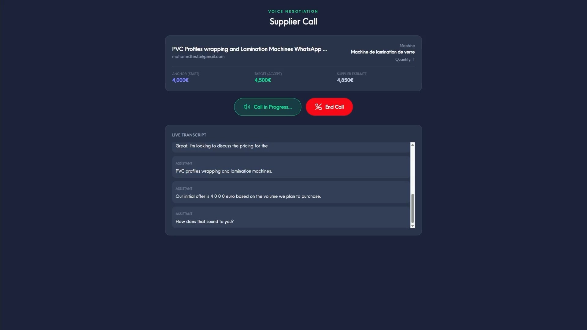

Business purpose:
- Support iterative negotiation with suppliers through text and voice channels
- Produce negotiation history and best-offer summaries

Implementation:
- Endpoints:
  - `POST /api/module5/text/negotiation`
  - `POST /api/module5/voice/negotiation`
  - `POST /api/module5/voice/summary`
- Route: `backend/routes/module_5.py`
- Negotiation core: `backend/utils/module_5/`
- Email integration: `backend/routes/email_service.py`

Frontend voice UI:
- `frontend/src/app/voice-call/page.tsx`

Primary output:
- Negotiation rounds, transcript data, and negotiated pricing traces

---

## Module 6 - TCO (Total Cost of Ownership)

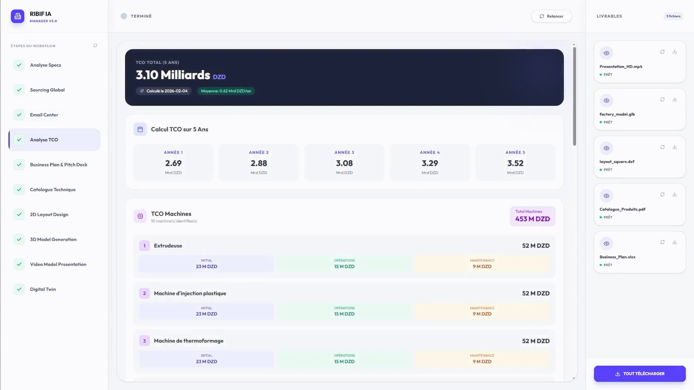

Business purpose:
- Estimate realistic industrial ownership cost over multi-year horizons
- Include acquisition, installation, operations, maintenance, and yearly projections

Implementation:
- Endpoints:
  - `POST /api/module6/tco-from-sourcing`
  - `POST /api/module6/tco`
- Route: `backend/routes/module6.py`
- Core model: `backend/utils/module_6/core.py`

Primary output:
- Machine/product/raw-material TCO breakdowns and annual projection

---

## Module 7 - Automatic Business Plan

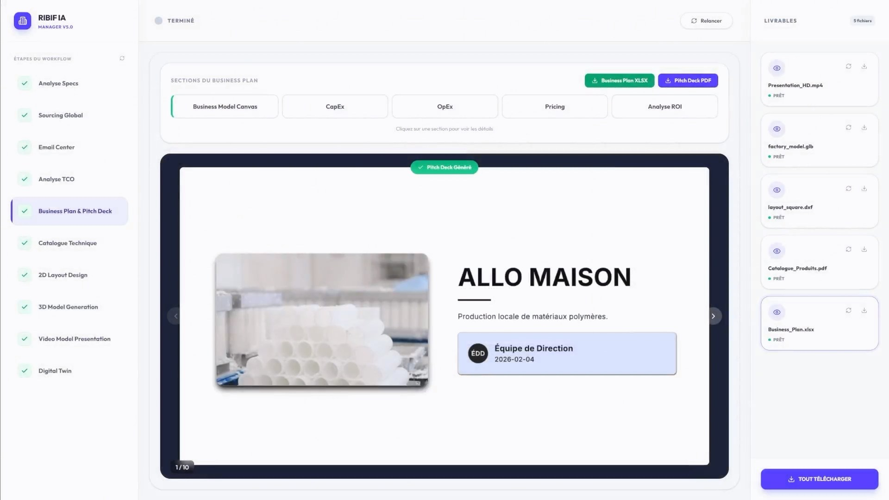

Business purpose:
- Transform technical and financial outputs into investor-facing business material
- Generate 5-year planning artifacts and pitch-ready content

Implementation:
- Endpoints:
  - `POST /api/module7/business-plan`
  - `POST /api/module7/pitch-deck`
- Route: `backend/routes/module7.py`
- Generators:
  - `backend/utils/module_7/business_plan.py`
  - `backend/utils/module_7/pitch_deck.py`

Primary output:
- Business plan assets and pitch deck outputs

---

## Module 8 - Digital Twin and Digital Brain

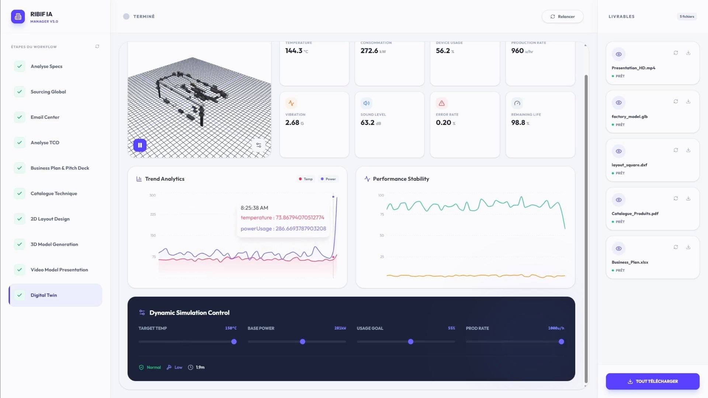

Business purpose:
- Provide an operational digital twin with KPI visualization and monitoring
- Expose throughput/availability/quality-style views for decision support

Implementation in this repo:
- Page route: `frontend/src/app/twin/page.tsx`
- Main view: `frontend/src/sections/DigitalTwinView.tsx`

Primary output:
- Live/interactive KPI and factory twin views in the frontend

---

## Module 9 - Automatic Technical Catalog

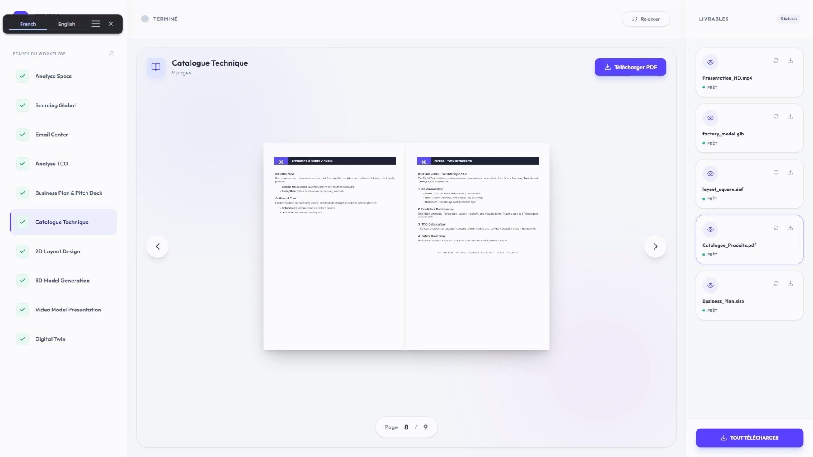

Business purpose:
- Produce reusable technical documentation and catalog output for equipment/process context

Implementation:
- Endpoint: `POST /api/module9/catalog`
- Route: `backend/routes/module9.py`
- Core generator: `backend/utils/module_9/core.py`

Primary output:
- Catalog payload and PDF-ready artifact links

---

## Supporting Views

### Home
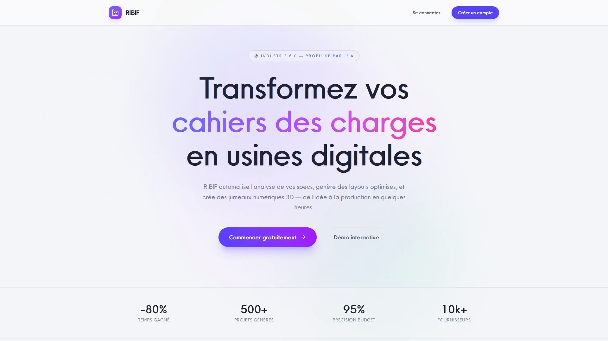

### Workflow Loading
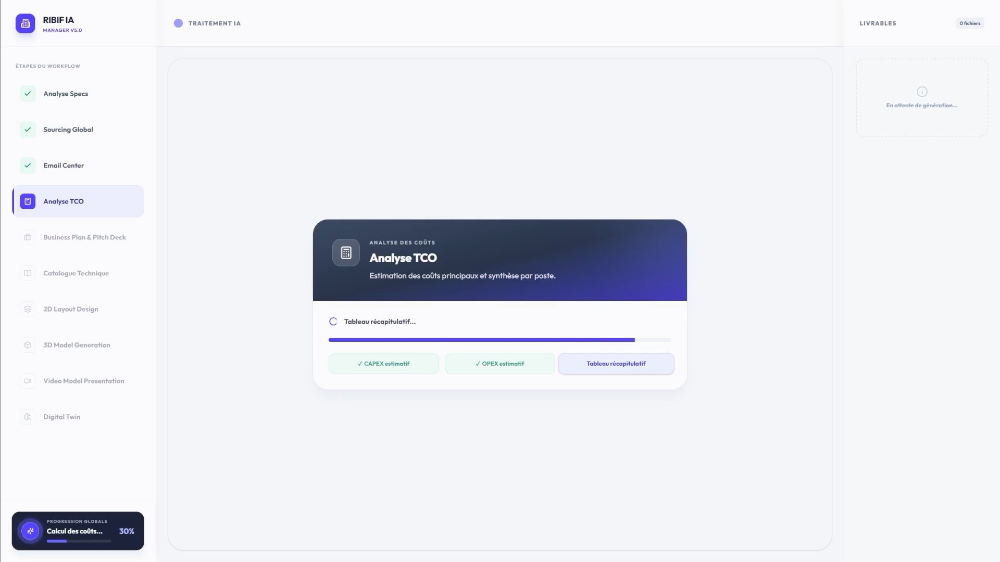

### PDF Preview
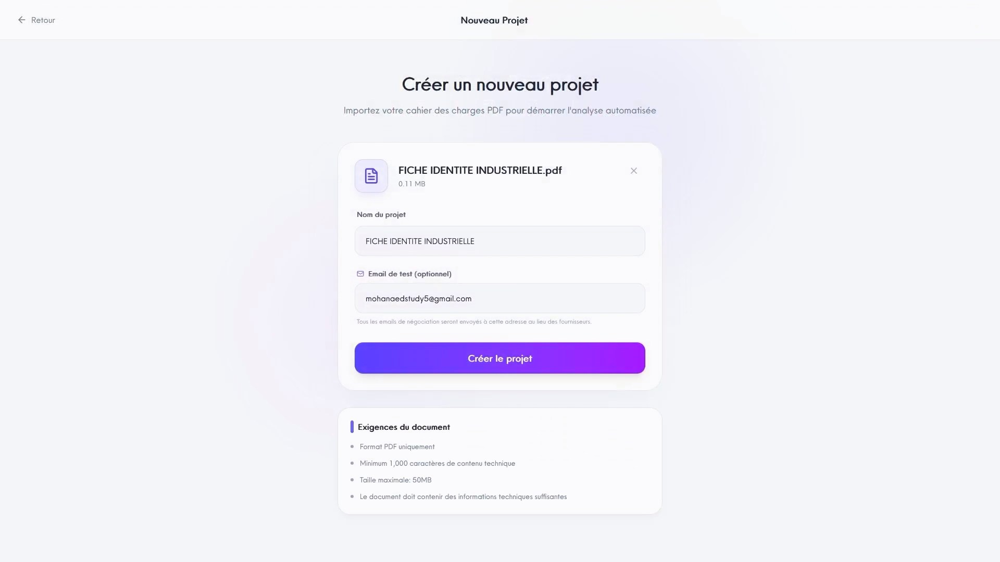

---

## Repository Structure

```text
ribif/
|- backend/
|  |- app.py
|  |- config.py
|  |- requirements.txt
|  |- pytest.ini
|  |- routes/
|  |  |- module1.py
|  |  |- module2.py
|  |  |- module3.py
|  |  |- module4.py
|  |  |- module_5.py
|  |  |- module6.py
|  |  |- module7.py
|  |  |- module9.py
|  |- utils/
|  |  |- module_1/
|  |  |- module_2/
|  |  |- module_4/
|  |  |- module_5/
|  |  |- module_6/
|  |  |- module_7/
|  |  |- module_9/
|  |  |- web_search/
|  |- tests/
|  |- template/        (saved module outputs used by SKIP_MODULE_<n>)
|- frontend/
|  |- src/app/
|  |- src/sections/
|  |- src/lib/
|  |- supabase/
```

---

## Environment Variables

Backend (`backend/.env`), main ones:
- `GOOGLE_API_KEY`, `GEMINI_MODEL`, `IMAGE_MODEL`, `VIDEO_MODEL`: Gemini and Veo
- `SUPABASE_URL`, `SUPABASE_SERVICE_ROLE_KEY`: persistence and file storage
- `SERPER_API_KEY`, `BING_API_KEY`, `WEB_SEARCH_ENABLED`, `PREFER_WEB_DATA`: supplier search
- `REPLICATE_API_TOKEN`: Module 2 3D model
- `PRESENTON_API_KEY`, `PRESENTON_API_BASE_URL`: Module 7 pitch deck
- `SMTP_HOST`, `SMTP_PORT`, `SMTP_USERNAME`, `SMTP_PASSWORD`, `IMAP_HOST`, `IMAP_PORT`: Module 5 email
- `SKIP_MODULE_<n>`: serve saved template output instead of running a module (see Status)
- `CORS_ORIGINS`, `BACKEND_BASE_URL`

Frontend (`frontend/.env.local`):
- `NEXT_PUBLIC_BACKEND_URL`
- `NEXT_PUBLIC_SUPABASE_URL`
- `NEXT_PUBLIC_SUPABASE_ANON_KEY`
- `NEXT_PUBLIC_VAPI_PUBLIC_KEY`

---

## API Surface (Core)

- `POST /api/module1/process`
- `GET /api/module1/status`
- `GET /api/module1/result`
- `POST /api/module2/layout`
- `POST /api/module3/video`
- `POST /api/module4/enrich`
- `POST /api/module5/text/negotiation`
- `POST /api/module5/voice/negotiation`
- `POST /api/module5/voice/summary`
- `POST /api/module6/tco-from-sourcing`
- `POST /api/module6/tco`
- `POST /api/module7/business-plan`
- `POST /api/module7/pitch-deck`
- `POST /api/module9/catalog`

Supporting:
- `GET /health`
- `GET /health/ready`
- `GET /health/live`
- `GET /health/metrics`
- `POST /api/validate-pdf`
- `POST /api/extract-text`
- `POST /api/email/send`
- `POST /api/email/poll`

---

## Quick Start

Prerequisites:
- Python 3.10+
- Node.js 20+
- `pnpm`

Backend:
```bash
cd backend
python -m venv .venv
.venv\Scripts\activate
pip install -r requirements.txt
python app.py
```

Frontend:
```bash
cd frontend
pnpm install
pnpm dev
```

Default URLs:
- Backend: `http://localhost:5000`
- Frontend: `http://localhost:3000`

---

## Development Verification

All of these run offline and need no keys.

Frontend:
```bash
cd frontend
pnpm lint
pnpm exec tsc --noEmit
pnpm test
```

Backend (`pytest` is limited to `tests/` by `pytest.ini`; `tests/conftest.py` blocks outbound network and never loads `.env`):
```bash
cd backend
python -m pytest
python test_imports.py
```

`test_full_enrichment.py`, `test_zero_shot_enrichment.py` and `run_enrichment_module1.py` in `backend/` are manual runners that call Gemini and the search APIs; `validate_stage5.py` is an older local check now covered by `tests/`. None of them are part of the suite.

---

## Known Limitations

- With the default per-machine budget, Module 4's first search pass uses every allowed query, so the second pass (contact-focused queries) never runs; supplier emails come only from the first pass.
- Module 4's supplier filter is keyword-based and untuned; it can reject legitimate manufacturers.
- Module 2 conveyor routes are valid but often take unnecessary bends around machine ports.
- The Module 3 clip merge (moviepy 2) and the Module 2 realistic render and 3D export have not been run.
- About 150 places in the frontend type backend JSON as `any`; lint reports them as warnings.
- `next build` was not run during the audit; the type-check, lint and unit tests were.
